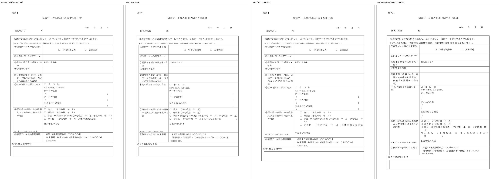

*同じ官公庁の研究申請フォーム（セル内で回転したラベル）を Word・Oxi・LibreOffice・SILURUS で描いたもの*

## 要約

- Rust + WebAssembly で .docx レンダリングエンジン **Oxi** を書いています。正解は毎回 **Microsoft Word 本体の出力**で、ページ割りとピクセル SSIM の 2 軸で測っています。
- 看板の数字を「チューニング済みコーパス」から「**初見 50 文書のブラインドセット**」に差し替えました。日本語ブラインド **0.828（4 エンジン中 1 位）**、英語ブラインド **0.807（3 位、負けている）**。
- 直したセットは伸びる一方で、**未知の英語文書での到着率はまだ横ばい**（46% → 55% → 50%）というのが正直な現在地です。
- 測定でハマった話（COM の数値を鵜呑みにしない、net で見る、打ち消し合う誤差）を残します。

- デモ: https://ryujiyasu.gitlab.io/oxi/docs.html （アップロード無し・全部ブラウザ内で動きます）
- ソース: https://gitlab.com/Ryujiyasu/oxi （MPL-2.0）

作っているものを一行で言うと「**既存の .docx を Word と同じ見た目で開くエンジン**」です。サーバ不要のクライアント完結で、ページ分割から行分割まで Word の結果を再現することを目標にしています。

---

## 現在地（2026-07-21）

初見 50 文書ずつのブラインドベンチマークです。正解は Microsoft Word 自身のレンダリング（150 DPI、リサイズして SSIM）。

### 日本語ブラインド 50 文書（初回測定 2026-07-21）

| エンジン | Word との SSIM（文書平均） | ページ数一致 |
|---|---|---|
| **Oxi** | **0.828** | 44 / 50 |
| LibreOffice 26.2.1.2 | 0.816 | 41 / 50 |
| SILURUS @silurus/ooxml 0.72.2 | 0.804 | 32 / 50 |
| ONLYOFFICE 9.3.1.8 | 0.772 | 38 / 50 |

同一文書での勝敗は LibreOffice に 33/50、SILURUS に 33/50、ONLYOFFICE に 40/50。
ページ割りも別途測っていて、**照合可能な 48 文書中 41 文書で全段落が Word と同じページ**に載りました（残り 2 文書はテキストが全部画像・テキストボックスの中にあり、そもそも段落を照合できない種類のファイル）。

### 英語ブラインド 50 文書（2026-07-20）

| エンジン | Word との SSIM（文書平均） | ページ数一致 |
|---|---|---|
| ONLYOFFICE 9.3.1.8 | 0.902 | 41 / 50 |
| LibreOffice 26.2.1.2 | 0.876 | 43 / 50 |
| **Oxi** | **0.807** | 38 / 50 |
| SILURUS @silurus/ooxml 0.72.2 | 0.776 | 35 / 50 |

こちらは負けています。アーキテクチャが一番近い SILURUS（同じく Rust + WebAssembly + canvas）には 32/50 で勝っていますが、成熟したネイティブスイート 2 つには届いていません。**これが今の作業キュー**で、直したら同じセットを測り直す運用です。

並べて見るときの注意を 2 つ。

1. 英語セットと日本語セットは**別の文書**なので、言語をまたいだ比較にはなりません。各表の中だけが比較可能です。
2. **エンジンの順位はコーパスをまたいで転移しません**。ONLYOFFICE は英語で 1 位、日本語で 4 位。だからこそ言語ごとにブラインドセットを持つ意味があります。

---

## なぜ「ブラインド」に変えたのか

ここが今回いちばん残しておきたいところです。

少し前まで、自分は「日本語 235 文書で SSIM 0.9378」「87 文書でページ割り 100% 一致」を看板にしていました。嘘ではありません。ただ、**その 87 文書は 1 文書ずつ原因を特定して直してきた文書**です。テストセットにひたすらフィットさせた結果の 100% であって、「次に来る知らない .docx でどうなるか」は何も言っていない。

機械学習では当たり前の話ですが、レンダリングエンジンでも構図はまったく同じでした。そこでコーパスを 3 つの役割に分けました。

| 役割 | 中身 | 修正対象にしてよいか |
|---|---|---|
| **dev** | ページ割りゲート 87 文書 + ピクセル SSIM 監視 238 文書 + 合成プローブ | よい（ここでバグを潰す） |
| **validation** | 一度ブラインドだったセットをローテーションで降格したもの | 降格後はよい |
| **blind** | 言語ごとに 50 文書。**測定前に凍結し、1 回だけ測り、解剖しない** | **だめ** |

ブラインドセットの選び方も先に固定します。公開コーパス（Common Crawl 由来の実 .docx、ODC-BY）から **文書タイプ 10 種 × SHA-256 昇順で次の 5 件**。品質による選別は一切せず、機械的な検疫（zip として妥当・`word/document.xml` がある・マクロ無し・4MB 以下）だけを通す。取得もスクリプト一発で決定的に再現できます。

新しいブラインドセットを凍結したら、古いほうを validation に降格して初めて「直してよい文書」になる。この一方通行だけを守っています。

看板の数字は blind、dev の数字は**ゲート（回帰検出）に格下げ**。README と Web サイトからは 235 文書の数字を全部落としました。

### で、汎化しているのか

到着時（＝まだ 1 度も直していない状態）のページ割り一致率の推移です。

| セット | 初回測定 |
|---|---|
| 英語 first-50 | 23/50（46%） |
| 英語 next-50 | 27/49（55%） |
| 英語 blind-50 | 24/48（50%） |
| **日本語 blind-50** | **41/48（85%）** |

英語は、規則を 30 個以上足しても**初見での到着率がほぼ横ばい**でした（バッチ間の難易度差の範囲内）。一方で、いったん解剖したセットは上がっていて、英語 100 文書（first + next）は今 77/100 です。つまり「**直したものは直る、けれど未知の英語文書の合格率はまだ伸びていない**」。仕様空間の裾が想像より広い、というのが現状認識です。

日本語が 85% なのは、そちらの導出を先に長くやってきた分が野良の日本語文書にも効いている、と解釈しています（ただし日本語の dev コーパスは官公庁規程が中心で、コーパスの性質差もあるはずなので割り引いて見ています）。

---

## 何を正解として測っているか

- **正解 = Microsoft Word 本体の出力**。自分の前回の出力とは絶対に比べません。
- 2 軸で測ります。
  - **ページ割り**: Word COM API で「この段落は何ページ目か」を全段落ぶん取って突き合わせる。見た目が似ていても中身が別ページに乗っていたら意味がないので。
  - **SSIM**: Word のレンダリング画像と自前レンダリング画像のピクセル比較。
- 仕様は**クリーンルーム**。逆アセンブル・バイナリ解析は一切なしで、公開規格（OOXML / ECMA-376）と、COM API・PDF 書き出し経由の**ブラックボックス観測**だけです。

実装で効いているのは、Word のレイアウトが GDI のテキストメトリクス（整数ピクセル丸め）の上に建っている点でした。丸め誤差はページをまたいで積み上がります。Calibri 11pt で 1 文字あたり 0.18pt の差でも、60 文字で 10.8pt になり、行分割とページ分割が動く。なので .docx は GDI をそのまま再現し、GDI の歴史を持たないフォーマット（.odt / PDF）は DirectWrite の浮動小数メトリクスを使う二本立てにしています。

---

## 測定でハマったこと

エンジンの中身より、**測り方でハマった話**のほうが再利用が効くと思うので書いておきます。

**1. 測定 API の数値を鵜呑みにしない。**
Word COM の座標系 API は返す値が量子化されていたり、範囲の取り方によっては「次のページ」を返したりします。行の高さのような 0.1pt 単位の話は、COM の数値ではなく **PDF に書き出してベースライン間隔を実測**しないと、もっともらしい定数を掴まされます。実際、ある間隔をずっと 13.75pt だと思っていて、PDF で測り直したら 14.0pt でした（0.75pt 量子化の下振れを定数だと思い込んでいた）。

**2. 「改善した」を net で見る。**
ある文書を直すと別の文書が悪化する、は日常茶飯事です。固定したベースラインに対して**全コーパスの絶対値を定期的に測り直す**運用にしないと、局所的な改善を積み上げているつもりで全体は横ばい、ということが起きます（起きました）。差分ツールが壊れていて「変化ゼロ」を返し続けていた時期もあり、それも全体再測定で気づきました。

**3. A/B は必ず両方リビルドしてから。**
片方のバイナリが古いと「差分ゼロ」という一番タチの悪い偽陽性が出ます。何度も踏みました。

**4. 合格している文書を壊す修正は、たいてい正しい修正。**
直した瞬間に他が壊れるのは、その文書が「2 つの誤差が打ち消し合った状態」で合格していたという意味です。片方だけ直すと隠れていたほうが露出する。ここで引き返さず、打ち消していたもう片方も特定するのが結局いちばん進みます。

---

## 残っていること

- **英語のギャップ**（ブラインド 0.807 → 成熟スイートの 0.88〜0.90）。最優先。
- ハイフネーション（`autoHyphenation`）が未実装。英文書でこれが有効だと 1 行あたりの詰め方が変わるので、確実にページがずれます。
- サブピクセル位置精度の壁。レイアウトは合っているのにラスタライズ位置が 0.1px 単位でずれて SSIM が伸びない領域が、日本語のフォーム系文書に残っています。
- .xlsx / .pptx は現状パースと基本描画まで。レイアウトエンジンはこれから。

---

## まとめ

- 初見 50 文書のブラインドで **日本語 0.828（4 エンジン中 1 位）・英語 0.807（3 位）**。
- 看板にする数字は blind に、チューニング済みコーパスの数字はゲートに降格した。
- 英語の初見到着率はまだ伸びていない、というのが正直な現在地。

数字はすべて、同じ入力・同じ正解（Word 本体）で再現できるようにしてあります。反例（Word とずれる .docx）を投げてもらえるのが一番ありがたいです。

- デモ: https://ryujiyasu.gitlab.io/oxi/docs.html
- リポジトリ: https://gitlab.com/Ryujiyasu/oxi
